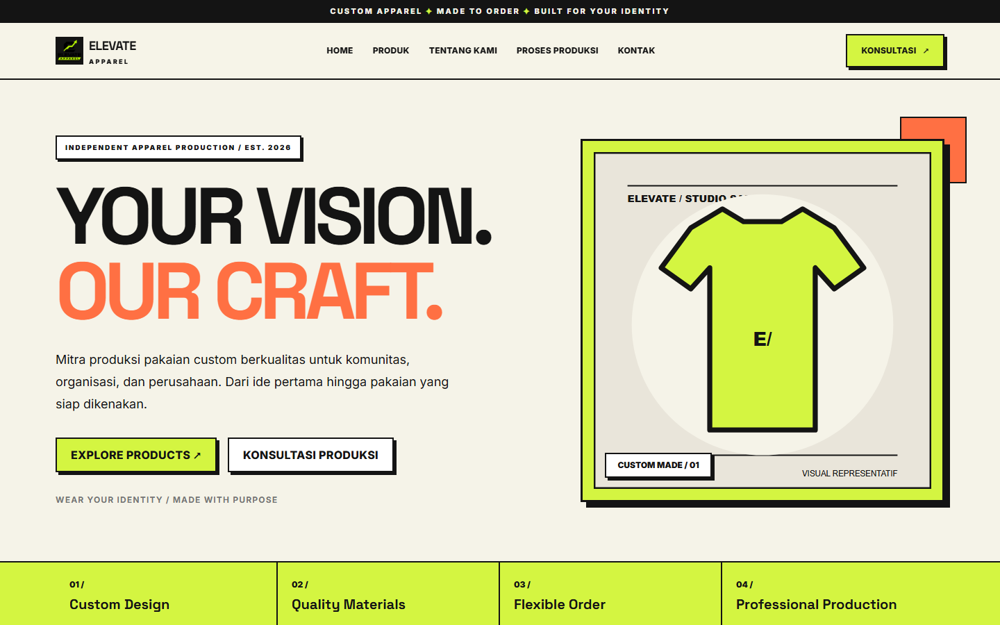
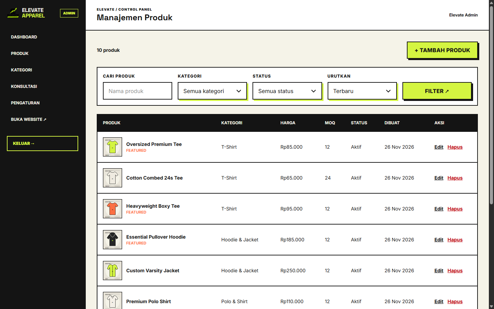

# ELEVATE APPAREL

Website katalog dan konsultasi produksi untuk **PT Elevate Apparel Karya Mandiri**. Dibangun sebagai aplikasi Laravel monolith dengan Blade, Tailwind CSS v4, Vite, session authentication, dan Eloquent. Harga dan produk awal adalah data simulasi untuk demonstrasi, bukan penawaran resmi.

## Pratinjau

**Home**



**Admin — data produk dari MySQL**



Tampilan lain: [home mobile](docs/screenshots/home-mobile.png) dan [dashboard admin](docs/screenshots/admin-dashboard.png).

## Persyaratan

- PHP **8.3 atau lebih baru** beserta ekstensi Laravel yang diperlukan; pengembangan proyek ini memakai PHP 8.4.
- Composer 2, Node.js 20.19+ atau 22.12+, npm, dan MySQL 8 atau SQLite.
- Laragon pada gambar menggunakan PHP 8.1. Ubah versi PHP Laragon ke 8.3+ bila menjalankan melalui Apache Laragon. `php artisan serve` dapat memakai PHP CLI 8.4 yang sudah tersedia.

## Instalasi

```bash
composer install
npm install
cp .env.example .env
php artisan key:generate
```

Di PowerShell, salin environment dengan `Copy-Item .env.example .env`. Sesuaikan `APP_URL` dengan alamat lokal. Untuk **MySQL Laragon port 3306**, buat database kosong `elevate_apparel` lewat phpMyAdmin atau MySQL, kemudian atur `.env`:

```dotenv
DB_CONNECTION=mysql
DB_HOST=127.0.0.1
DB_PORT=3306
DB_DATABASE=elevate_apparel
DB_USERNAME=isi_pengguna_mysql
DB_PASSWORD=isi_sandi_mysql
```

Gunakan kredensial MySQL milik instalasi Anda. Bila belum siap, biarkan `DB_CONNECTION=sqlite` untuk development. Set admin development dalam `.env` sebelum seeding:

```dotenv
ADMIN_NAME="Elevate Admin"
ADMIN_EMAIL=admin@example.test
ADMIN_PASSWORD=buat_sandi_kuat_di_sini
```

Jika sandi mengandung `#`, bungkus nilainya dengan tanda kutip ganda di `.env`, misalnya `ADMIN_PASSWORD="Sandi#Lokal"`. Tanpa kutip, bagian setelah `#` dapat dibaca sebagai komentar. Nilai di atas adalah contoh konfigurasi, bukan akun bawaan. **Jangan gunakan kredensial development pada produksi.** Seeder hanya membuat admin bila email dan sandi diisi. Jalankan:

```bash
php artisan migrate --seed
php artisan storage:link
npm run build
php artisan serve
```

Situs tersedia di `http://127.0.0.1:8000`, panel admin di `/admin/login`. Untuk pengembangan CSS/JS, gunakan `npm run dev` pada terminal lain. Setelah build, `php artisan serve` cukup untuk presentasi. Jika `.env` admin diubah kemudian, jalankan `php artisan db:seed --class=AdminSeeder`.

## Fitur

**Publik:** `/`, `/products`, `/products/{slug}`, `/about`, `/process`, `/contact`. Katalog mendukung pencarian, kategori, rentang harga, urutan harga/terbaru, dan pagination melalui query parameter. Produk nonaktif disembunyikan. Form konsultasi menyimpan data ke database dan menampilkan pesan berhasil.

**Admin:** `/admin/dashboard`, `/admin/products`, `/admin/categories`, `/admin/inquiries`, `/admin/settings`. Tersedia CRUD produk dan kategori, unggah gambar ke Laravel public storage, perubahan status konsultasi, serta pengaturan profil bisnis. Gate `access-admin` membatasi panel untuk akun admin. Penghapusan kategori berisi produk ditolak. Penghapusan produk mempertahankan inquiry dan mengosongkan `product_id`.

## Struktur folder inti

```text
app/
  Http/Controllers/          # controller publik dan Admin/
  Http/Requests/             # validasi form server side
  Models/                    # User, Category, Product, Inquiry, BusinessSetting
database/
  migrations/                # skema dan foreign key
  factories/                 # data terisolasi untuk tes
  seeders/                   # lima seeder di bawah
resources/
  css/app.css                # Tailwind dan token visual
  js/app.js                  # interaksi dropdown, menu, preview gambar
  views/                    # layout, komponen, halaman publik dan admin
routes/web.php               # seluruh route publik dan admin
public/images/               # logo, favicon, ilustrasi produk/kategori
storage/app/public/          # gambar hasil upload admin
tests/Feature/               # tes HTTP dan aturan bisnis
docs/                        # skema, hasil tes, screenshot
```

Definisi endpoint ada di [routes/web.php](routes/web.php). Lima file seeder:

| File | Fungsi |
| --- | --- |
| [DatabaseSeeder.php](database/seeders/DatabaseSeeder.php) | Memanggil seluruh seeder dalam urutan yang aman. |
| [BusinessSettingSeeder.php](database/seeders/BusinessSettingSeeder.php) | Mengisi identitas perusahaan awal. |
| [CategorySeeder.php](database/seeders/CategorySeeder.php) | Mengisi lima kategori contoh. |
| [ProductSeeder.php](database/seeders/ProductSeeder.php) | Mengisi sepuluh produk contoh dan relasi kategori. |
| [AdminSeeder.php](database/seeders/AdminSeeder.php) | Membuat akun admin dari variabel `.env`. |

## Database

`categories` memiliki banyak `products`; `products` memiliki banyak `inquiries`. `users` menyimpan akun admin dan `business_settings` menyimpan konfigurasi bisnis satu baris. Seeder idempotent mengisi 5 kategori dan 10 produk contoh. Detail skema di [docs/DATABASE.md](docs/DATABASE.md).

## Pengujian

```bash
php artisan test
npm run build
php artisan route:list
```

Tes memakai SQLite `:memory:` terpisah dan `Storage::fake('public')`, sehingga tidak menyentuh database development. Hasil eksekusi terakhir dicatat di [docs/TESTING.md](docs/TESTING.md).

## Checklist UTS

- [x] Laravel, Blade, Tailwind CSS, Vite, logo SVG, dan identitas usaha.
- [x] Migration, foreign key, model Eloquent, dan seeder 10 produk.
- [x] Katalog dinamis, detail produk, filter, dan form konsultasi.
- [x] Login admin, CRUD produk dan kategori, upload gambar public storage.
- [x] Validasi server side (`required`, `max`, `numeric`/`integer`, `image`).
- [x] Desain responsif dan tes fitur otomatis.

Visual produk dalam seeder adalah ilustrasi SVG lokal, bukan foto hasil produksi pelanggan. Sumber dan batasannya dicatat di [ASSETS.md](ASSETS.md).

Gunakan Conventional Commits (`feat:`, `fix:`, `style:`, `test:`, `docs:`, `chore:`). Jangan commit `.env`, database pribadi, `vendor`, atau `node_modules`.
